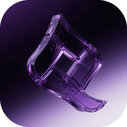

# QWIZERO Studio

Редактор изображений и моушн-графики для Windows 11 — в одном приложении.



## Возможности

### Режим «Фото»
- **Слои**: неограниченное количество, 16 режимов наложения, непрозрачность, маски, дублирование, объединение, блокировка, переименование, изменение порядка
- **Инструменты (21)**: перемещение, рука, масштаб, пипетка, прямоугольное/овальное выделение, лассо, волшебная палочка, кадрирование, кисть, карандаш, ластик, штамп (клонирование), размытие/резкость, осветлитель/затемнитель, градиент, заливка, текст, фигуры (прямоугольник, эллипс, линия, многоугольник)
- **Коррекции**: яркость/контраст, экспозиция, уровни, кривые (интерактивный редактор), тон/насыщенность, цветовой баланс, температура, сочность, автоконтраст
- **Фильтры**: размытие по Гауссу, размытие в движении, радиальное (zoom) размытие, резкость, контурная резкость, тиснение, выделение краёв, масляная живопись, полутон (растр), шум, пикселизация, виньетка, инверсия, Ч/Б, сепия, порог, постеризация
- **История**: отмена/повтор (Ctrl+Z / Ctrl+Y)
- **Файлы**: открытие PNG/JPG/WebP/BMP/GIF, проекты `.qwz` (сохраняют все слои и маски), экспорт PNG/JPG/WebP

### Режим «Моушн»
- **Композиции**: произвольный размер, fps (1–120), длительность, цвет фона
- **Слои композиции**: из фотодокумента, цветные плашки, текст
- **Ключевые кадры**: позиция X/Y, масштаб, поворот, непрозрачность; линейная и плавная интерполяция; перетаскивание ключей по таймлайну
- **Эффекты**: размытие на слой
- **Плейбэк**: предпросмотр в реальном времени (Пробел)
- **Экспорт видео**: WebM (встроенно) и MP4/H.264 (через FFmpeg)

### Горячие клавиши
| Клавиша | Действие |
|---|---|
| V / H / Z / I | Перемещение / Рука / Масштаб / Пипетка |
| M / L / W / C | Выделение / Лассо / Палочка / Кадрирование |
| B / E / S / R / O / G / T / U | Кисть / Ластик / Штамп / Размытие / Осветлитель / Градиент / Текст / Фигуры |
| Ctrl+Z / Ctrl+Y | Отмена / Повтор |
| Ctrl+N / Ctrl+O / Ctrl+S | Новый / Открыть / Сохранить проект |
| Ctrl+A / Ctrl+D | Выделить всё / Снять выделение |
| [ и ] | Размер кисти |
| X / D | Поменять цвета / Цвета по умолчанию |
| Пробел (удерж.) | Рука (в фото) / Плейбэк (в моушн) |

---

## Как получить exe (установщик Windows)

1. Создайте **Private**-репозиторий на [github.com](https://github.com) (кнопка **New repository**).
2. Загрузите в него **всё содержимое этого архива**, включая скрытую папку `.github`
   (через веб-интерфейс: *Add file → Upload files* — перетащите все файлы и папки).
3. В репозитории откройте вкладку **Actions** → слева выберите **Build Windows exe** →
   нажмите **Run workflow** → **Run workflow**.
4. Подождите 5–10 минут. Когда запуск завершится (зелёная галочка), откройте его —
   внизу страницы в разделе **Artifacts** будет **QWIZERO-Studio-Setup** — это архив с установщиком `.exe`.
5. Скачайте, распакуйте и запустите установщик. QWIZERO Studio появится в меню «Пуск» и на рабочем столе.

> Workflow запускается автоматически и при каждом `push` в ветку `main`/`master`.

## Запуск из исходников (для разработки)

Требуется [Node.js 20+](https://nodejs.org):

```bash
npm install
npm start        # запуск приложения
npm run dist     # сборка установщика в папку dist/
```

## Структура проекта

```
QWIZERO-Studio/
├── main.js                 # Главный процесс Electron (окно, диалоги, FFmpeg)
├── preload.js              # Мост IPC
├── package.json            # Зависимости и конфигурация сборки
├── assets/                 # Иконки приложения
├── src/
│   ├── index.html          # Интерфейс
│   ├── styles.css          # Тёмная тема
│   └── js/
│       ├── editor.js       # Фоторедактор (слои, инструменты, фильтры)
│       └── motion.js       # Моушн-редактор (таймлайн, ключи, экспорт)
└── .github/workflows/
    └── build.yml           # GitHub Actions: сборка exe для Windows
```

---

© QWIZERO. Лицензия MIT.
